<h1 align="center">Hi, I'm Andi</h1>

  

  PHP developer focused on AI engineering. 
  I build LLM agents, RAG and MCP tools, and the backend systems that hold them together.

---

<table>
  <tr>
    <td valign="top" width="33%">

### Languages

</td>
    <td valign="top" width="33%">

### Backend & Data

</td>
    <td valign="top" width="33%">

### Frontend

</td>
  </tr>
  <tr>
    <td valign="top" width="33%">

### Infra

</td>
    <td valign="top" colspan="2">

### AI

</td>
  </tr>
</table>

---

